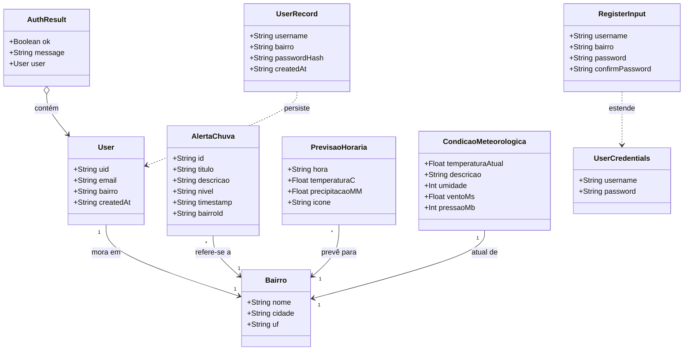
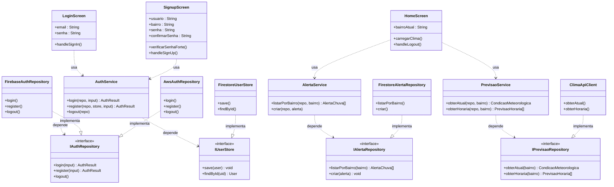
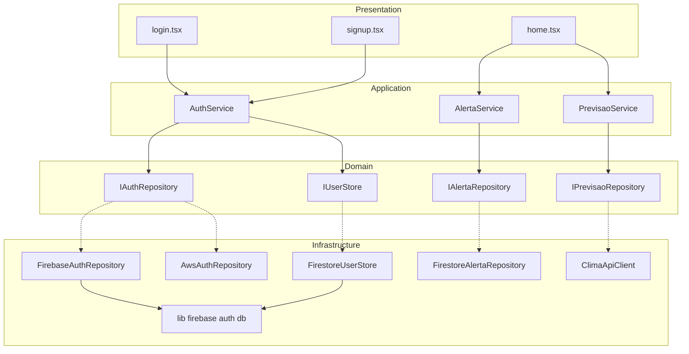
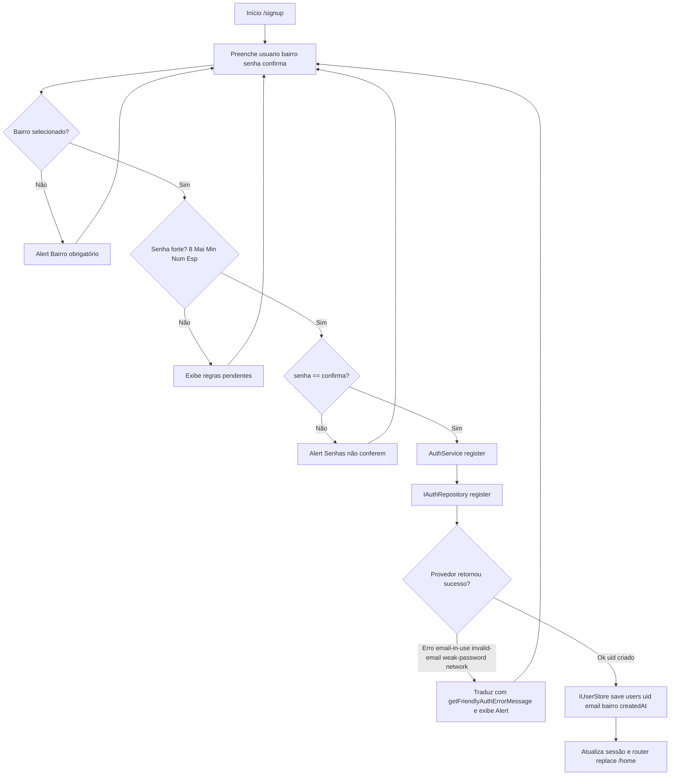
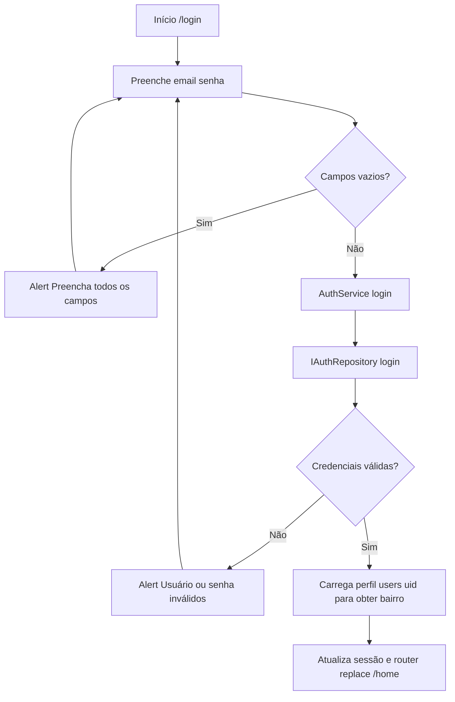
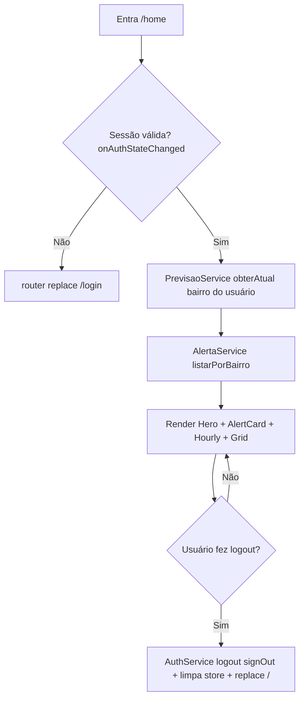
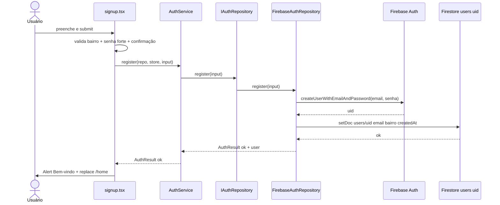
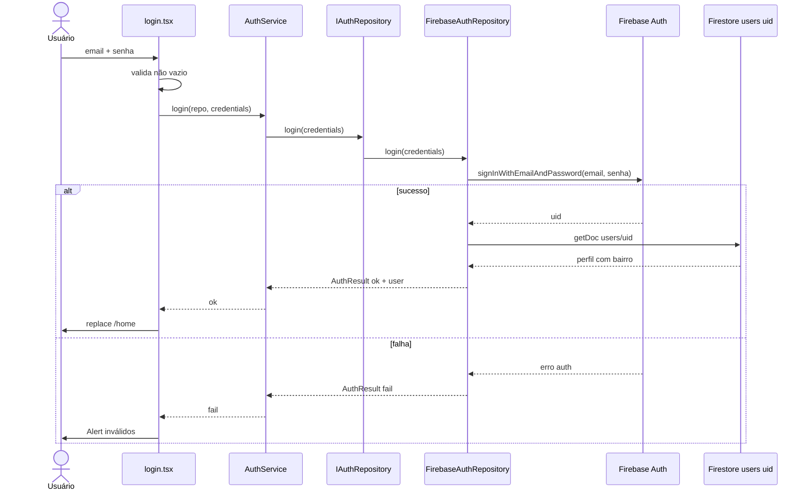
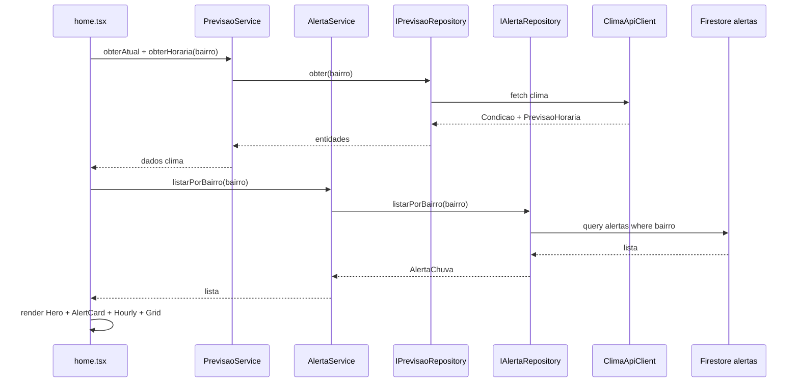
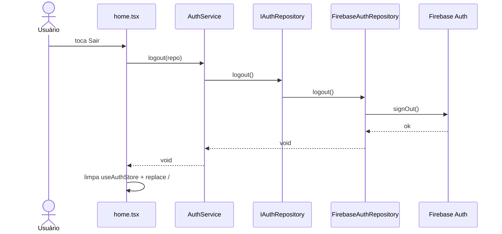

# Documento de Projeto — AlertaChuva Recife

> Finalidade: especificação do design ideal para implementação por outra IA.
> Padrão adotado: Arquitetura em Camadas (Presentation / Application / Domain / Infrastructure) + Interfaces + Princípio da Inversão de Dependências.
> Stack atual: Expo Router + React Native + TypeScript + Zustand + Firebase Auth + Firestore + AsyncStorage.

---

## 1. Visão geral funcional

Aplicativo de alerta de chuva para Recife-PE.

Rotas atuais (Expo Router, `src/app/`):

- `/` (`index.tsx`): landing com gradiente, logo, botão "Começar" -> `/login`. Sem estado, sem backend.
- `/login` (`login.tsx`): formulário e-mail + senha. Valida campos vazios. Autentica e vai para `/home`.
- `/signup` (`signup.tsx`): formulário usuário/e-mail + bairro (modal com 72 bairros de `src/data/bairros.ts`) + senha + confirmar senha. Valida bairro obrigatório, senha forte (`>=8 + maiúscula + minúscula + número + especial`), confirmação igual. Cadastra e vai para `/home`.
- `/home` (`home.tsx`): dashboard meteorológico. Hoje 100% mock estático: header "Olá + Recife,PE", HeroCard 28° + "Pancadas moderadas", AlertCard "Atenção chuva forte próximas 2h", previsão horizontal 18h-22h, grid umidade/vento/temperatura/pressão. Botão Sair apenas navega para `/`, sem `signOut`.

Entidades funcionais envolvidas: Usuário, Bairro/Localização, Alerta de chuva, Previsão horária, Condição meteorológica atual, Sessão/Credenciais.

---

## 2. Diagnóstico da arquitetura atual

Camadas existentes:

- `Presentation`: `src/app/*.tsx`, `src/components/button.tsx`, `input.tsx`, `logo-placeholder.tsx`, `src/contexts/authContext.tsx`
- `Dados estáticos`: `src/data/bairros.ts`
- `Infraestrutura`: `src/lib/firebase.ts` (inicializa App + Auth com persistência AsyncStorage + Firestore), `src/lib/firebase-errors.ts`
- `Contratos legados isolados`: `src/backend/types.ts`, `auth.repository.ts`, `auth.service.ts` — não usados pelas telas

Pontos de acoplamento a corrigir:

1. `src/app/login.tsx` importa `auth` de `src/lib/firebase.ts` e chama `signInWithEmailAndPassword` diretamente.
2. `src/app/signup.tsx` importa `auth` e chama `createUserWithEmailAndPassword` diretamente.
3. `db` (Firestore) é exportado em `src/lib/firebase.ts` mas nunca usado. Bairro, perfil e alertas nunca são persistidos.
4. `signOut`, `onAuthStateChanged`, `updateProfile` nunca usados. Logout não encerra sessão. `home.tsx` não tem guarda de autenticação.
5. `src/contexts/authContext.tsx` (Zustand `useAuthStore` com `usuario, senha`) só é usado em `signup.tsx`. `login.tsx` usa `useState` local. Não guarda `uid`, `bairro`, token ou sessão.
6. Config Firebase está hardcoded em `src/lib/firebase.ts`. Ideal: `EXPO_PUBLIC_*` + `.env`.

Arquitetura alvo: telas nunca importam SDK de banco/auth. Telas dependem de interfaces do domínio. Infraestrutura implementa as interfaces. Trocar Firebase por AWS ou outro provedor exige criar apenas uma classe nova de infraestrutura, sem alterar telas ou casos de uso.

Regra de dependência obrigatória:

```
Presentation -> Application -> Domain <- Infrastructure
```

---

## 3. Arquitetura proposta em camadas

```
Presentation
  app/_layout.tsx, app/index.tsx, app/login.tsx, app/signup.tsx, app/home.tsx
  components/Button, Input, LogoPlaceholder
  contexts/authContext.tsx (apenas estado de sessão: uid, email, bairro. Sem SDK)

Application (casos de uso, sem SDK)
  services/AuthService: login(), register(), logout()
  services/AlertaService: listarPorBairro(), criar(), obterPorId()
  services/PrevisaoService: obterCondicaoAtual(), obterPrevisaoHoraria()

Domain (entidades + interfaces puras, sem import de firebase/aws)
  entities: User, Bairro, AlertaChuva, PrevisaoHoraria, CondicaoMeteorologica
  value objects: UserCredentials, RegisterInput, AuthResult
  interfaces: IAuthRepository, IUserStore, IAlertaRepository, IPrevisaoRepository, IClimaApiClient

Infrastructure (única camada que conhece SDK)
  FirebaseAuthRepository implements IAuthRepository
  FirestoreUserStore implements IUserStore
  FirestoreAlertaRepository implements IAlertaRepository
  ClimaApiClient implements IPrevisaoRepository (pode iniciar com mock dos dados de home.tsx)
  lib/firebase.ts, lib/firebase-errors.ts, AsyncStorage persistence
  // Provedor alternativo futuro: AwsAuthRepository implements IAuthRepository

Cross-cutting
  data/bairros.ts, theme.ts, lib/firebase-errors.ts
```

Estrutura de pastas a ser criada pela IA implementadora:

```
src/
  domain/
    entities.ts
    repositories.ts
  application/
    auth.service.ts
    alerta.service.ts
    previsao.service.ts
  infrastructure/
    firebase-auth.repository.ts
    firestore-user.store.ts
    firestore-alerta.repository.ts
    clima-api.client.ts
  app/
  components/
  contexts/
  data/
  lib/
```

---

## 4. Diagrama de classes de domínio

Modelo conceitual. Sem dependência de framework, Firebase ou AWS.



Dicionário:

- `User`: usuário autenticado. `uid` vem do provedor de auth. `email` = campo `usuario` das telas. `bairro` é obrigatório no cadastro e deve ser persistido em `users/{uid}`.
- `Bairro`: valores de `src/data/bairros.ts` (72 bairros), `cidade=Recife`, `uf=PE`.
- `AlertaChuva`: `nivel` em `info|atencao|critico`. Hoje existe apenas como mock `AlertCard` em `home.tsx`. Deve virar coleção `alertas`.
- `PrevisaoHoraria`: itens da lista horizontal de `home.tsx` (18h-22h, temp + mm + ícone).
- `CondicaoMeteorologica`: HeroCard + grid de `home.tsx` (28°, pancadas moderadas, umidade 82%, vento 4.8m/s, pressão 1012mB).
- `UserCredentials`, `RegisterInput`, `AuthResult`, `UserRecord`: já esboçados em `src/backend/types.ts`. `RegisterInput` deve incluir `bairro`. `AuthResult` deve incluir `user` opcional. Nunca trafegar senha em texto puro fora da camada Presentation -> Application. Persistir apenas hash/perfil, nunca senha plain.

---

## 5. Diagrama de classes estrutural (camadas + interfaces)

Mostra como Presentation depende de abstrações e Infrastructure implementa. É o design que a IA deve codificar.



Diagrama de componentes correspondente:



Restrições para a IA:

- `app/*.tsx` não podem importar `firebase/auth`, `firebase/firestore` ou `lib/firebase`. Apenas `application/*.service.ts`, `domain/*` e `contexts`.
- `application/*` não pode importar SDK. Recebe repositório por parâmetro/injeção.
- `domain/*` não importa nada externo.
- `infrastructure/*` é o único lugar com `signInWithEmailAndPassword`, `createUserWithEmailAndPassword`, `signOut`, `onAuthStateChanged`, `collection`, `doc`, `setDoc`, `getDocs`.
- `AwsAuthRepository` é prova de troca: mesma interface, zero mudança em telas.

---

## 6. Diagramas de atividades

### 6.1 Cadastro (`/signup`)



Regras: `verificarSenhaForte()` permanece na Presentation ou vira validador no Application. `bairro` deve ser salvo no passo K (hoje não é salvo — lacuna a corrigir).

### 6.2 Login (`/login`)



### 6.3 Visualização de alertas (`/home`)



Estado atual: `/home` pula B, C, D e renderiza E com dados fixos. A IA deve implementar B, C, D mantendo o layout.

---

## 7. Diagramas de sequência

### 7.1 Cadastro — design ideal



Cenário alternativo: `FA` retorna erro -> `F` converte via `getFriendlyAuthErrorMessage` -> `A` retorna `AuthResult ok=false` -> `S` exibe Alert e permanece na tela.

### 7.2 Login — design ideal



### 7.3 Home — carregar clima e alertas (futuro, desacoplado)



Nota: primeira versão de `ClimaApiClient` pode retornar os mesmos mocks de `home.tsx` para não quebrar UI. Evolução posterior pluga API real sem alterar `home.tsx`.

### 7.4 Logout — design ideal



---

## 8. Contratos a implementar (esqueleto para a IA)

### 8.1 `src/domain/entities.ts`

```ts
export type Bairro = { nome: string; cidade: string; uf: string };
export type User = { uid: string; email: string; bairro: string; createdAt: string };
export type AlertaChuva = {
  id: string; titulo: string; descricao: string;
  nivel: "info" | "atencao" | "critico";
  timestamp: string; bairroId: string;
};
export type PrevisaoHoraria = {
  hora: string; temperaturaC: number; precipitacaoMM: number;
  icone: "rainy" | "thunderstorm" | "cloud";
};
export type CondicaoMeteorologica = {
  temperaturaAtual: number; descricao: string;
  umidade: number; ventoMs: number; pressaoMb: number;
};
export type UserCredentials = { username: string; password: string };
export type RegisterInput = UserCredentials & { bairro: string; confirmPassword: string };
export type AuthResult = { ok: boolean; message: string; user?: User };
```

### 8.2 `src/domain/repositories.ts`

```ts
import type { AlertaChuva, AuthResult, CondicaoMeteorologica, PrevisaoHoraria, RegisterInput, User, UserCredentials } from "./entities";

export interface IAuthRepository {
  login(input: UserCredentials): Promise<AuthResult>;
  register(input: RegisterInput): Promise<AuthResult>;
  logout(): Promise<void>;
}
export interface IUserStore {
  save(user: User): Promise<void>;
  findById(uid: string): Promise<User | null>;
}
export interface IAlertaRepository {
  listarPorBairro(bairro: string): Promise<AlertaChuva[]>;
  criar(alerta: Omit<AlertaChuva, "id">): Promise<AlertaChuva>;
}
export interface IPrevisaoRepository {
  obterAtual(bairro: string): Promise<CondicaoMeteorologica>;
  obterHoraria(bairro: string): Promise<PrevisaoHoraria[]>;
}
```

Base existente: reaproveitar tipos de `src/backend/types.ts` e interface de `src/backend/auth.repository.ts`, estendendo com `bairro` e `user` em `AuthResult`, e adicionando `IUserStore`, `IAlertaRepository`, `IPrevisaoRepository`.

### 8.3 `src/application/auth.service.ts`

- `login(repo: IAuthRepository, input: UserCredentials): Promise<AuthResult>` — apenas valida não-vazio e delega. Sem import Firebase.
- `register(repo: IAuthRepository, store: IUserStore, input: RegisterInput): Promise<AuthResult>` — valida bairro, senha forte, confirmação; chama `repo.register`; em sucesso chama `store.save`. Sem import Firebase.
- `logout(repo: IAuthRepository): Promise<void>`.
- Migrar lógica hoje em `src/backend/auth.service.ts` (usuário provisório `admin/admin`) e validações hoje duplicadas em `signup.tsx`/`login.tsx`.

### 8.4 `src/infrastructure/firebase-auth.repository.ts`

Único arquivo que importa `firebase/auth` + `auth` de `src/lib/firebase.ts`:

- `login`: `signInWithEmailAndPassword(auth, trim(email), senha)` + `getDoc users/uid` para montar `User`.
- `register`: `createUserWithEmailAndPassword` + `setDoc users/uid { email, bairro, createdAt }`.
- `logout`: `signOut(auth)`.
- Erros convertidos com `getFriendlyAuthErrorMessage` de `src/lib/firebase-errors.ts`.

### 8.5 `src/infrastructure/firestore-*.ts` e `clima-api.client.ts`

- `FirestoreUserStore`: `setDoc(doc(db, "users", uid), ...)`, `getDoc`.
- `FirestoreAlertaRepository`: `collection(db, "alertas")`, `query where bairroId == bairro`, `addDoc`.
- `ClimaApiClient`: primeira versão retorna mocks extraídos de `home.tsx` (28°, 82%, 4.8m/s, 1012mB, lista 18h-22h). Segunda versão chama API real. `home.tsx` não muda entre as versões.

### 8.6 Ajustes nas telas

- `login.tsx`: remover `import { auth }`, `signInWithEmailAndPassword`. Usar `new FirebaseAuthRepository()` + `AuthService.login()`. Manter `Input`, `Button`, `Alert`, `router.replace("/home")`.
- `signup.tsx`: remover `createUserWithEmailAndPassword` direto. Usar `AuthService.register()` + `FirestoreUserStore`. Manter modal de `bairrosRecife`, `verificarSenhaForte()`, `Regra()`, `getFriendlyAuthErrorMessage`.
- `home.tsx`: adicionar guarda com `onAuthStateChanged` (via repository/store, não direto), buscar dados via `PrevisaoService`/`AlertaService`, trocar `onPress router.replace("/")` por `AuthService.logout()` + limpeza de `useAuthStore`.
- `contexts/authContext.tsx`: evoluir store para `{ uid, email, bairro, setSession, clearSession }`. Remover `senha` em texto puro da store.
- `lib/firebase.ts`: mover `firebaseConfig` para `EXPO_PUBLIC_FIREBASE_*` + atualizar `.env.example`. Manter `initializeAuth` com `AsyncStorage`.

Coleções Firestore propostas:

```
users/{uid}: { email: string, bairro: string, createdAt: timestamp }
alertas/{id}: { titulo, descricao, nivel, timestamp, bairroId }
previsoes/{bairroId}: { atual: CondicaoMeteorologica, horaria: PrevisaoHoraria[] } // opcional, cache
```

---

## 9. Checklist de aceitação para a IA implementadora

- [ ] Nenhum arquivo em `app/`, `components/`, `contexts/`, `application/`, `domain/` importa `firebase/`.
- [ ] Telas de auth operam apenas via `IAuthRepository` + `AuthService`.
- [ ] Cadastro persiste `users/{uid}` com `email, bairro, createdAt`.
- [ ] Login carrega perfil para obter `bairro`.
- [ ] Logout executa `signOut` e limpa store.
- [ ] `home.tsx` possui guarda de sessão e consome `IAlertaRepository` / `IPrevisaoRepository` (mesmo que com mock inicial).
- [ ] É possível adicionar `AwsAuthRepository implements IAuthRepository` sem alterar telas ou services.
- [ ] Fluxos `/ -> /login -> /signup -> /home` preservados. `Button`, `Input`, `bairrosRecife`, mensagens de erro em PT-BR e layout atual mantidos.
- [ ] Diagramas das seções 4–7 continuam válidos após a refatoração (nomes de classes/métodos idênticos ou mapeados).

---

## 10. Referências de arquivos atuais

- Telas: `src/app/index.tsx`, `src/app/login.tsx`, `src/app/signup.tsx`, `src/app/home.tsx`, `src/app/_layout.tsx`
- UI: `src/components/button.tsx`, `src/components/input.tsx`, `src/components/logo-placeholder.tsx`
- Estado: `src/contexts/authContext.tsx`
- Dados: `src/data/bairros.ts`
- Infra: `src/lib/firebase.ts`, `src/lib/firebase-errors.ts`
- Contratos legados: `src/backend/types.ts`, `src/backend/auth.repository.ts`, `src/backend/auth.service.ts`, `src/backend/README.md`
- Design: `src/theme.ts`, `src/assets/logo.png`, `img1.png`, `img2.png`, `docs/design-referencias.md`
